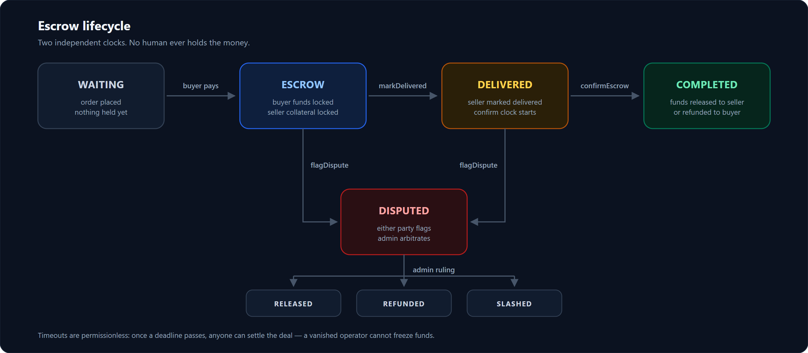

# SlimeMarket — DoraHacks submission pack (Arc Microgrants, Round 1)

Everything below is copy-paste ready for the project page on DoraHacks.
Every on-chain fact was re-verified against Arc mainnet (`chainId 5042`) on **2026-10-20** via
`eth_getTransactionReceipt` on `https://rpc.mainnet.arc.io` — not copied from old notes.

> **Polished English page copy:** [`DORAHACKS_PROJECT_PAGE.md`](DORAHACKS_PROJECT_PAGE.md) — that is
> the file to paste into the DoraHacks editor. This file is the working pack (eligibility mapping,
> evidence tables, checklist).


---

## 0. Field map — what goes where

| DoraHacks field | Use section |
|---|---|
| Project name | `SlimeMarket` |
| Tagline / one-liner | §1 |
| Short description | §2 |
| Full description (Markdown) | §3 |
| Tech stack / tags | §4 |
| Links — website | `https://slimemarket.app` |
| Links — GitHub | `https://github.com/SlimeMarket/slimemarket` (public) |
| Links — demo video | **TODO: you must record this** (see §7) |
| Links — X / Farcaster | **TODO: paste your public profile** |
| Contract address | `0xfe76c63289dd8b5693277df261e4938bd8779d28` |
| Example transaction | `0xb35c3fac051f5611ee3c06b117f79a9e7dd8c11563c22b8695f4201740e0ea5c` |
| Team | **TODO: name or pseudonym** |

---

## 1. One-liner

> A peer-to-peer OTC marketplace where a smart contract replaces the human middleman — buyer funds
> and seller fraud collateral are locked in USDC on Arc, and settlement is deterministic.

Shorter variant (for a card/subtitle):

> Trustless OTC escrow on Arc. The middleman is a contract.

---

## 2. Short description (~90 words)

> High-value digital-asset trades — whitelist spots, wallet handovers, mint services — still happen
> in Telegram DMs through a trusted human escrow agent. That person is the single point of failure,
> the fee, and the reason deals stay small.
>
> SlimeMarket puts that flow on-chain. Buyer funds and seller fraud collateral are locked in
> `MarketEscrow.sol` on Arc; two independent deadlines (delivery, then confirmation) remove the
> "whoever calls first wins" race, and anyone can settle after a deadline if the operator vanishes.
> Live on Arc mainnet, settling in USDC.

---

## 3. Full description (paste into the Markdown body)

```markdown
# SlimeMarket — trustless OTC escrow on Arc

## The problem

A large share of high-value digital-asset trading does not happen on an exchange. Whitelist spots,
wallet handovers, mint services, airdrop-eligible accounts — they trade in Telegram DMs, and they
trade through a **human escrow agent** (a "rekber"): someone who holds the money and decides who is
right when a deal goes wrong.

That model has three structural costs:

1. **Counterparty risk is concentrated in one person.** The escrow agent can vanish, take a side, or
   simply be wrong. There is no appeal.
2. **It caps deal size.** Nobody escrows $5,000 through a stranger on Telegram.
3. **It is slow and manual.** Settlement depends on someone being awake.

## What SlimeMarket does

SlimeMarket moves that exact flow on-chain. The middleman becomes a contract.

- The buyer's payment and the seller's **fraud collateral** are locked in `MarketEscrow.sol`.
- The seller marks delivery; the buyer confirms. If the buyer goes silent past the confirmation
  deadline, the seller is paid.
- If either side disputes, the platform admin acts as **arbitrator only** — not as custodian. The
  money never sits with a human.
- On a fraud ruling the seller's collateral is **slashed to the buyer**, so the collateral is real
  insurance rather than decoration.

### The escrow lifecycle



| From | Trigger | To | Who can call it |
|---|---|---|---|
| `WAITING` | buyer funds the order | `ESCROW` | buyer, or relay operator with a signed permit |
| `ESCROW` | seller marks delivered | `DELIVERED` | seller |
| `DELIVERED` | buyer confirms | `COMPLETED` — released to seller | buyer |
| `DELIVERED` | confirmation deadline passes | `COMPLETED` — seller paid | **anyone** |
| `ESCROW` | delivery deadline passes | `CANCELLED` — buyer refunded | **anyone** |
| `ESCROW` / `DELIVERED` | either party flags a problem | `DISPUTED` | buyer or seller |
| `DISPUTED` | admin arbitrates | `RELEASED` / `REFUNDED` / `SLASHED` | platform admin |
| `DISPUTED` | 30 days with no ruling | `CANCELLED` — buyer wins by default | **anyone** |

> Do **not** use ASCII box diagrams on DoraHacks — box-drawing characters collapse in their
> renderer. Use the PNG above, or the table.

### Design decisions that matter

**Two independent clocks, not one.** `deliveryDeadline` is set at funding; `confirmDeadline` is set
when the seller marks delivered. Both are per-deal and clamped to `[1 hour, 365 days]`. A whitelist
spot ships in minutes; an airdrop-eligible wallet may only pay out months later — a single fixed
timeout would be wrong for both.

**Funds cannot be stranded.** `releaseEscrowAfterTimeout` and `refundEscrowAfterTimeout` are
permissionless: once the relevant clock has passed, *anyone* can settle. A vanished operator cannot
freeze a deal. There is also a 30-day dispute backstop after which the buyer is the default winner.

**Fees are explicit and paid by the buyer.** Marketplace order: buyer pays `amount + 2%`, seller
receives `amount − 2%`. OTC deal: buyer pays `price + 2%`, seller receives 100%. The buyer fee is
non-refundable and stays collected even on a refund — it pays for the rail.

**Money math never touches floats.** All amounts are `bigint` micro-USDC (6 decimals) end to end,
from the API boundary to the contract call.

## Why Arc

The escrow settles in USDC, so the chain had to treat USDC as a first-class citizen:

- **USDC is the native gas token.** No ETH faucet, no second token, no "you need gas to move your
  money". For users coming from Telegram — not crypto natives — a balance that is also gas removes
  an entire onboarding step.
- **Sub-second deterministic finality.** Escrow enforces two clocks. On a chain where a transaction
  can sit for minutes, the clock you enforce is not the clock the user experiences.
- **Circle-native rails.** User-Controlled Wallets (email OTP login, PIN-signed challenges), USDC,
  and Gateway share one identity and one balance model across funding, swapping, bridging and
  settlement.

## What is live today

| Piece | Status |
|---|---|
| `MarketEscrow.sol` on Arc mainnet (`0xfe76…9d28`) | **Live**, 4 orders settled end-to-end |
| Marketplace checkout (external wallet + Circle UCW) | **Live** |
| Order lifecycle, delivery, release, refund | **Live** |
| Seller center, stock, reviews, wallet, bridge/swap | **Live** |
| OTC deal flow with collateral + disputes | Implemented in the contract and covered by tests; UI gated behind a "coming soon" flag while we finish it |

## What's next

1. Ship the OTC deal UI (collateral, disputes, timeout escapes) — the contract path is already tested.
2. Reputation that travels with the wallet, not the account.
3. Multi-asset settlement: same escrow, different stablecoins.
4. Operator tooling so a marketplace can run its own escrow instance on the same contract.

## Verification

Contract `0xfe76c63289dd8b5693277df261e4938bd8779d28` on Arc mainnet, USDC
`0x3600000000000000000000000000000000000000` (6 dp). Eight mainnet transactions, all `status = 1`,
all moving USDC through the escrow — see the table below. Anyone can re-check them with a single
`eth_getTransactionReceipt` call.
```

---

## 4. Tech stack (for the tags / stack field)

`Solidity` · `Arc` · `USDC` · `Escrow` · `Marketplace` · `Next.js` · `React` · `Node.js` ·
`PostgreSQL (Supabase)` · `Circle User-Controlled Wallets` · `Circle Developer-Controlled Wallets` ·
`CCTP` · `viem` · `Hardhat` · `OpenZeppelin` · `Vitest` · `Playwright`

Detail worth quoting if there is a free-text stack field:

- **Contract** — Solidity 0.8 + Hardhat + OpenZeppelin. `MarketEscrow.sol`: escrow deals, marketplace
  orders, seller collateral, disputes, timeout escapes, operator gas budgets.
- **App** — Next.js 15 App Router (route handlers are the API) + React 19 SPA in `public/`,
  Tailwind, Recharts. 150+ API endpoints, Zod-validated bodies.
- **Data** — Supabase Postgres, 99 migrations, RLS on every table. `bigint` micro-USDC, never float.
- **Wallets** — Circle UCW for users (email OTP → PIN challenge, MPC key shares, non-custodial),
  Circle DCW for treasury / relayer / operator.
- **Tests** — 802 unit (Vitest), 106 contract (Hardhat), 23 on-chain lifecycle, 10 Playwright.
- **Ops** — Ubuntu 24.04, nginx, PM2, Let's Encrypt, Upstash Redis rate limiting, pino + Sentry.

---

## 5. On-chain proof — all verified 2026-10-20

| # | What it proves | Transaction | Block | UTC | USDC |
|---|---|---|---|---|---|
| 1 | Buyer funds order #0 — `OrderCreated` emitted | [`0x3cee387b…c0547e`](https://explorer.arc.io/tx/0x3cee387bd946875067a0418b614b0437a833ad2d6832fa751b39008e1ec0547e) | 26092238 | 2026-10-15 12:25 | 0.051 in |
| 2 | Order #0 released to seller — `OrderReleased` | [`0x6f4539e6…5830cad`](https://explorer.arc.io/tx/0x6f4539e614099affa33a327c84c6132f2019ed62ab6dd46c8c6b3f35f5830cad) | 26092568 | 2026-10-15 12:27 | 0.049 out |
| 3 | Buyer funds order #1 (external wallet, EIP-2612 permit relayed) | [`0xb35c3fac…0ea5c`](https://explorer.arc.io/tx/0xb35c3fac051f5611ee3c06b117f79a9e7dd8c11563c22b8695f4201740e0ea5c) | 26372139 | 2026-10-17 04:00 | 0.102 in |
| 4 | Order #1 released to seller | [`0x99546836…34b877`](https://explorer.arc.io/tx/0x995468369786f086f8052dff04c738057700c40df8a9543495fe42cd1a34b877) | 26372357 | 2026-10-17 04:02 | 0.098 out |
| 5 | Buyer funds order #2 | [`0x07a4ed6a…5c6b4d`](https://explorer.arc.io/tx/0x07a4ed6a1094bbf162b8f380a28405c79b38aa531c0c77a4e3e74144425c6b4d) | 26541444 | 2026-10-18 03:50 | 0.0714 in |
| 6 | Order #2 released to seller | [`0x9ee4f88c…b7fb0eb4`](https://explorer.arc.io/tx/0x9ee4f88ced1c4c13bcfd73a48147cd63540716dc6a7e859f3291e836b7fb0eb4) | 26542124 | 2026-10-18 03:56 | 0.0686 out |
| 7 | Buyer funds order #3 | [`0x2c1b7c39…9774607`](https://explorer.arc.io/tx/0x2c1b7c396338592b1c73ccc20f0eadee42be9e3339bf89b44d29ad6189774607) | 26588842 | 2026-10-18 10:30 | 0.1428 in |
| 8 | Order #3 released to seller | [`0x9387cbfe…4b8b30`](https://explorer.arc.io/tx/0x9387cbfec1d60e74b9f13e8c7f1c66015d18ec829f45df6cb1f9aeaa3f4b8b30) | 26589443 | 2026-10-18 10:35 | 0.1372 out |
| 9 | Circle UCW (email-OTP wallet) sends USDC out — no platform key involved | [`0x83d285c8…3a90e`](https://explorer.arc.io/tx/0x83d285c8522f5afe17023047216f43ebe542212a96303f5670c1601d2b13a90e) | 26396070 | 2026-10-17 07:22 | 0.144 out |

**Summary:** 4 marketplace orders opened and settled end-to-end on Arc mainnet, **0.72 USDC** moved
through `MarketEscrow`, every transaction `status = 1`. Values are deliberately small — this is a
live production deployment, not a funded demo, and the escrow is not audited.

**Re-verify in one command** (no login, no API key):

```bash
curl -s https://rpc.mainnet.arc.io -H 'Content-Type: application/json' \
  -d '{"jsonrpc":"2.0","id":1,"method":"eth_getTransactionReceipt",
       "params":["0xb35c3fac051f5611ee3c06b117f79a9e7dd8c11563c22b8695f4201740e0ea5c"]}' \
  | jq '{status: .result.status, to: .result.to, block: .result.blockNumber}'
# → {"status":"0x1","to":"0xfe76c63289dd8b5693277df261e4938bd8779d28","block":"0x192682b"}
```

### Deployment facts

| Item | Value |
|---|---|
| Network | Arc mainnet |
| Chain ID | `5042` (`0x13b2`) |
| RPC | `https://rpc.mainnet.arc.io` |
| Escrow | `0xfe76c63289dd8b5693277df261e4938bd8779d28` |
| USDC (ERC-20, 6 dp) | `0x3600000000000000000000000000000000000000` |
| Explorer | `https://explorer.arc.io` |
| Live app | `https://slimemarket.app` |
| Repo | `https://github.com/SlimeMarket/slimemarket` |

Deeper decode (calldata, logs, permit signature, per-order mapping to DB rows):
[`docs/MAINNET_VERIFICATION.md`](MAINNET_VERIFICATION.md).

---

## 6. Eligibility self-check

| # | Criterion | Status | Evidence |
|---|---|---|---|
| 1 | Open to individuals and teams worldwide, subject to sanctions screening | ✅ | Individual builder, no restricted jurisdiction |
| 2 | Pseudonymous builders can submit; verification only after selection | ✅ | Submission is pseudonymous; identity available privately for payout |
| 3 | One submission per project | ✅ | Single submission for SlimeMarket |
| 4 | **Project deployed and working on Arc mainnet at time of submission** | ✅ | 9 verified mainnet transactions (§5); app live at `slimemarket.app` (HTTP 200) |
| 5 | Hackathon projects are eligible | ✅ | Built for the Arc ecosystem; no prior Circle/Arc funding |
| 6 | Work must be yours or you must have the right to submit it | ✅ | Original work, single builder, full source in public repo |
| 7 | Microgrant paid in USDC on Arc; need a wallet that can receive USDC on Arc | ✅ | Payout wallet to be provided at verification (USDC on Arc) |
| 8 | You keep full ownership — no equity, no IP assignment, no exclusivity | ✅ | Acknowledged; repo stays under our ownership |
| 9 | Program dates and microgrant counts may be adjusted | ✅ | Acknowledged |

**Nothing here depends on testnet, mockups, or a slide deck.** Every claim in §5 is a mainnet
transaction hash.

---

## 7. What you still have to add yourself

These cannot be produced by the agent — do them before you hit save on the project page:

1. **Demo video (2–4 min).** Show, in order:
   - `slimemarket.app` → open a product → checkout
   - the wallet prompt / permit signature
   - the order landing in the seller dashboard
   - seller marks delivered → buyer confirms → release
   - then open the release tx on `explorer.arc.io` so the hash on screen matches §5
2. **Public builder profile** — GitHub (`github.com/SlimeMarket`) or your X / Farcaster handle.
3. **Team line** — name or pseudonym + one sentence of background.
4. **Screenshots** — at minimum: home/explore, product page, checkout, seller order view.
5. **Payout wallet** — an address that can receive USDC on Arc (only needed after selection).

---

## 8. Notes on what changed in the repo docs

While assembling this pack, three inaccuracies in the existing docs were fixed:

- `README.md` and `docs/MAINNET_VERIFICATION.md` linked to `arc.etherscan.io`; the Arc explorer used
  everywhere else (and by Arc itself) is `explorer.arc.io`. All 9 links corrected.
- `README.md` still described the chain as **Arc testnet (5042002)** in the tech-stack table, the
  architecture diagram, and the source tree — production is **Arc mainnet (5042)**. Corrected.
- `docs/MAINNET_VERIFICATION.md` had no record of the four settled orders; they are now listed with
  block numbers and UTC timestamps in §5.
